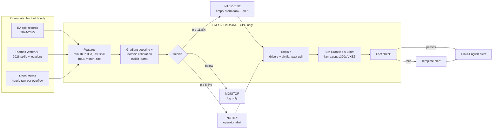
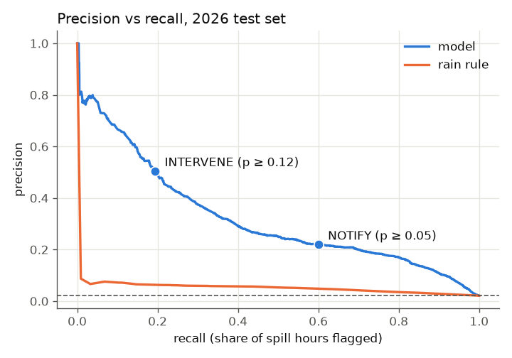

# Triton: early warning for sewage spills, on IBM Z

Triton predicts which Thames Water storm overflows are about to spill sewage
into rivers, up to 6 hours ahead, and decides what to do about it: start
emptying the storm tank automatically, alert an operator with a plain-English
explanation written by IBM Granite, or just keep watching. Everything, from the
machine learning model to the language model, runs on the CPU of an IBM z17
LinuxONE virtual machine.

**IBM Z Datathon 2026 · AI for Good · Real-Time AI for Critical Decisions
(Detect → Decide → Respond) · Predictive AI + Generative AI**

## The problem

When heavy rain overwhelms a sewer, storm overflows release diluted raw sewage
into rivers to stop it backing up into homes. Thames Water's overflows recorded
**31,861 spill events in 2024** alone (Environment Agency data). Operators find
out when a spill has already started. A few hours of warning is enough to
pump a storm tank down to the treatment works, divert flow, or warn river users.

## What Triton does

| Step | What happens | Where |
|---|---|---|
| **Detect** | Every hour, a calibrated gradient-boosting model scores each overflow: the chance a new spill starts in the next 6 hours. It uses rain at the overflow (last hour to last 30 days), how recently it last spilled, and the time of day and year. | `src/triton/features.py`, `src/triton/model.py` |
| **Decide** | **INTERVENE** (p ≥ 11.8%): start emptying the storm tank and alert. **NOTIFY** (p ≥ 5.3%): alert an operator. **MONITOR**: log only. Thresholds come from test-set precision and recall. | `src/triton/decision.py`, `configs/decision.json` |
| **Respond** | For each alert, Triton works out what is driving the prediction and finds the most similar past spill at that site. IBM Granite 4.0 (running locally through llama.cpp) writes the explanation; a fact check rejects any number or claim not in the facts and falls back to a template, so an alert is always sent. | `src/triton/alerts.py` |



## Results

Trained on 2024 and 2025, tested on 1 January to 15 October 2026, which the model
never saw. 40 overflows, 243,161 test hours, 862 spill episodes. All numbers are
from the run on the IBM z17.

| | Triton model | Rain-only rule | Always guess the average |
|---|---|---|---|
| PR-AUC (higher is better) | **0.320** | 0.049 | 0.021 |
| ROC-AUC | **0.930** | 0.720 | 0.500 |
| Brier score (lower is better) | **0.0187** | 0.0206 | 0.0209 |
| Precision when catching ~60% of spill hours | **22%** | 5% | |
| Alert-hours per day at that level (40 sites) | **49** | 234 | |

| Decision level | Precision | Spill hours flagged | Spill episodes warned | Median warning |
|---|---|---|---|---|
| NOTIFY (p ≥ 5.3%) | 22% | 60% | **654 of 862 (76%)** | **5.25 h** |
| INTERVENE (p ≥ 11.8%) | 50% | 19% | 239 of 862 (28%) | 5.0 h |

**Live replay of the 7-9 January 2026 storm on the z17:** 33 spills started,
21 were warned beforehand (median 1.8 h ahead), 32 alerts raised, 11 of them not
followed by a spill within 6 hours. Granite wrote 23 of the alerts; 9 failed the
fact check and used the template.



What drives the predictions (permutation importance): how recently the
overflow last spilled, the site itself, rain over the last 30 days (how wet the
ground is), and the **hour of day** (spills peak at 7-9am and 6-8pm, when the
daily sewage flow peak tips a full treatment works over).

Full numbers: [`outputs/metrics.json`](outputs/metrics.json). Figures:
[`outputs/figures/`](outputs/figures/). Exploration:
[`notebooks/eda_spills.ipynb`](notebooks/eda_spills.ipynb).

## How it uses IBM Z and LinuxONE

- **Runs on an IBM z17** (machine type 9175, s390x, Ubuntu 24.04, 3 vCPUs, 8 GB RAM, no GPU). Data download, feature building, training, inference and the language model all run on the LinuxONE VM.
- **Predictive AI on the CPU:** scikit-learn's gradient boosting trains on 583,838 rows in 23 seconds on the z17 and scores all 40 overflows in milliseconds per hour. The whole pipeline (download, features, training, evaluation) runs in about 9 minutes.
- **Generative AI on the CPU:** IBM Granite 4.0 350M runs through llama.cpp, compiled on the VM with its s390x vector (VXE2) code path, at about 13 seconds per alert on 3 vCPUs. No GPU and no cloud API: sewage-network data never leaves the machine.
- **Big-endian handled properly:** s390x is big-endian. IBM publishes little-endian GGUF files, so `scripts/get_granite.py` byte-swaps the model with the `gguf` converter. Trained scikit-learn models are refused if they were built on a machine with a different byte order (`model.load_bundle`), so the deployed model is always trained on the Z itself.
- **Only packages that work on s390x:** pandas, numpy, scikit-learn, matplotlib and plotly; data stored as compressed CSV because pyarrow has no s390x build.

## Run it

Needs [uv](https://docs.astral.sh/uv/). `uv sync` installs Python 3.13 and the
locked dependencies.

```bash
git clone https://github.com/kensei23/Triton_IBM-Z-Datathon-2026-Project.git
cd Triton_IBM-Z-Datathon-2026-Project
uv sync
uv run pytest -q
uv run python scripts/run_all.py
```

`run_all.py` downloads the data (about 7 minutes the first time, cached after),
builds the features, trains and evaluates the model, downloads Granite (366 MB,
once) and replays a real storm. Add `--skip-fetch` to reuse downloaded data and
`--no-llm` to skip Granite.

**On IBM Z (s390x):** llama.cpp asks for `-march=arch15` on a z17, which needs
GCC 15. With Ubuntu 24.04's GCC 13, build for z16 instead (z17 runs it natively,
vector extensions included). Do this once:

```bash
CMAKE_ARGS="-DGGML_NATIVE=OFF -DCMAKE_C_FLAGS=-march=z16 -DCMAKE_CXX_FLAGS=-march=z16" uv sync
```

**On Windows**, building llama-cpp-python needs the Visual Studio C++ Build Tools
(`winget install Microsoft.VisualStudio.2022.BuildTools`, with the C++ workload).

### Step by step

| Command | What it does | Output |
|---|---|---|
| `scripts/fetch_data.py --top-n 40` | Spill events, overflow locations, hourly rain at each overflow | `data/raw/*.csv.gz` |
| `scripts/build_features.py` | Merges monitor flicker into spill episodes, builds the hourly table | `data/processed/model_table.csv.gz` |
| `scripts/train.py` | Trains, compares with the rain rule, picks thresholds, saves figures | `models/spill_model.joblib`, `outputs/`, `configs/decision.json` |
| `scripts/get_granite.py` | Downloads Granite, converts to big-endian on IBM Z | `models/llm/*.gguf` (never committed) |
| `scripts/alert_example.py` | Explains one prediction and writes its alert | terminal |
| `scripts/demo_replay.py --delay 0.6` | Replays a real storm hour by hour, as if live | terminal, `outputs/demo_timeline.html` |

Run each with `uv run python <script>`; add `--help` for options.

## How it was built

- **Data:** spill start/stop events for 547 overflows since January 2024. Monitors often flicker on and off through one storm, so spills less than 6 hours apart are merged into one episode (23,374 events become 4,355 episodes at the 40 modelled overflows). Rain is fetched at each overflow's own location; grid references are converted to latitude and longitude with the Ordnance Survey formulas in pure Python.
- **No leakage:** every feature at hour t uses only data up to t. A test rewrites everything after a cut-off (rain, spills, the end of a spill still running) and checks no earlier feature changes.
- **Time-based evaluation:** train on 2024-2025, test on 2026. Never a random split.
- **Honest comparison:** a rain-only rule, tuned to catch the same share of spill hours, needs nearly five times as many alerts.
- **Language model guard rails:** Granite only writes the explanation; the headline (site, risk level, probability) and the automatic action are written by code. Its sentence is rejected if it contains a number not in the facts, pairs a rain amount with the wrong time window, mentions a time span the facts don't, repeats the probability or makes a comparison.

97 tests (`uv run pytest`) cover the data parsing, coordinate conversion,
features and leakage, model evaluation, decisions, alert checks and the replay.
They use synthetic data and never touch the network.

## Limitations

- **40 overflows, mostly rural treatment works** in Oxfordshire, Berkshire and Essex (the busiest that report every year). Many central London outfalls were connected to the Thames Tideway Tunnel in 2025.
- **No rain forecast yet.** Features use rain that has already fallen, so warnings are limited to a few hours. Archived Open-Meteo forecasts would let the model see rain that is coming.
- **Thresholds were chosen on the test period**, so the two decision-level rows are slightly optimistic. PR-AUC and Brier do not depend on them.
- **Probabilities are low** (spills start in about 2% of hours) and the top decile is under-confident.
- **Some overflows spill for weeks** because of groundwater, which rain alone explains poorly.
- **Granite 350M is small and slow here.** About a quarter of its sentences fail the fact check and are replaced by the template, and each alert takes about 13 seconds on the VM's 3 vCPUs (1.5 seconds on a laptop), so a storm with many alerts queues them.

## Data sources

| Data | Source | Licence |
|---|---|---|
| Spill events 2024-2025 | [Environment Agency, Event Duration Monitoring](https://environment.data.gov.uk/) | [Open Government Licence v3.0](https://www.nationalarchives.gov.uk/doc/open-government-licence/version/3/) |
| Spill events 2026, overflow locations | [Thames Water Open Data API v2](https://docs.api.thameswater.co.uk/) | [Thames Water terms](https://data.thameswater.co.uk/s/terms-of-service) |
| Hourly rain | [Open-Meteo Historical Weather API](https://open-meteo.com/en/docs/historical-weather-api) | [CC BY 4.0](https://creativecommons.org/licenses/by/4.0/), weather data by Open-Meteo.com |

Details, URLs and download dates: [`data/README.md`](data/README.md).

## Open-source software

| | |
|---|---|
| Language model | [IBM Granite 4.0 350M](https://huggingface.co/ibm-granite/granite-4.0-350m-GGUF) (Apache 2.0) |
| LLM runtime | [llama.cpp](https://github.com/ggml-org/llama.cpp), [llama-cpp-python](https://github.com/abetlen/llama-cpp-python), [gguf](https://pypi.org/project/gguf/) (byte-order conversion) |
| Machine learning | [scikit-learn](https://scikit-learn.org/), [NumPy](https://numpy.org/), [SciPy](https://scipy.org/), [pandas](https://pandas.pydata.org/), [joblib](https://joblib.readthedocs.io/) |
| Charts | [Matplotlib](https://matplotlib.org/), [Plotly](https://plotly.com/python/), [seaborn](https://seaborn.pydata.org/) |
| Data access | [Requests](https://requests.readthedocs.io/), [openpyxl](https://openpyxl.readthedocs.io/) |
| Tooling | [uv](https://github.com/astral-sh/uv), [Ruff](https://github.com/astral-sh/ruff), [pytest](https://pytest.org/), [pre-commit](https://pre-commit.com/), [Hatch](https://hatch.pypa.io/), [Jupyter](https://jupyter.org/) |

## Repository layout

```
src/triton/          features, model, decision, alerts, replay, data download
scripts/             runnable steps (fetch, build, train, demo, run_all)
tests/               pytest suite, synthetic data only
configs/             decision thresholds, Granite settings and prompts
notebooks/           exploratory analysis
outputs/             metrics, figures, demo timeline
models/              trained model (LLM weights in models/llm are not committed)
data/                README only; data is downloaded by fetch_data.py
docs/                video script and submission checklist
```

## Team

- Aaron Derin
- Oscar Denche
- Daniel Jones
